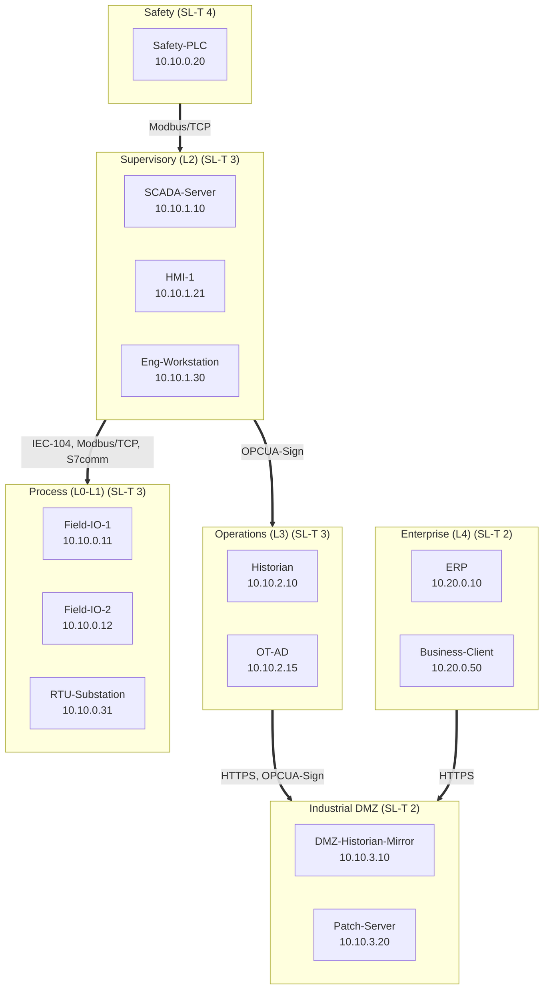

# IEC 62443 zone & conduit model — assets.csv

- Zones: **6**, conduits: **5**, defined flows: **10**

## Zones and suggested SL-T

| Zone | Purdue level | Assets | Criticality | Suggested SL-T |
|---|---|---:|---|:---:|
| Enterprise (L4) | 4 | 2 | medium | **2** |
| Industrial DMZ | 3.5 | 2 | medium | **2** |
| Operations (L3) | 3 | 2 | high | **3** |
| Process (L0-L1) | 1 | 3 | high | **3** |
| Safety | 1 | 1 | safety | **4** |
| Supervisory (L2) | 2 | 3 | high | **3** |

> SL-T is a **starting suggestion** from asset criticality, to be confirmed by a risk assessment per IEC 62443-3-2.

## Conduits

### Supervisory (L2) ⟷ Process (L0-L1)
- SCADA-Server → Field-IO-1: **Modbus/TCP** 502 — Poll and command line 1 PLC (bidirectional)
- SCADA-Server → Field-IO-2: **Modbus/TCP** 502 — Poll and command line 2 PLC (bidirectional)
- SCADA-Server → RTU-Substation: **IEC-104** 2404 — Substation telemetry and control (bidirectional)
- Eng-Workstation → Field-IO-1: **S7comm** 102 — PLC programming (maintenance window only) (bidirectional)

### Safety ⟷ Supervisory (L2)
- Safety-PLC → SCADA-Server: **Modbus/TCP** 502 — Safety status to SCADA (read-only) (unidirectional)

### Supervisory (L2) ⟷ Operations (L3)
- SCADA-Server → Historian: **OPCUA-Sign** 4840 — Historise process data (unidirectional)

### Operations (L3) ⟷ Industrial DMZ
- Historian → DMZ-Historian-Mirror: **OPCUA-Sign** 4840 — One-way replication OT -> DMZ (unidirectional)
- Patch-Server → OT-AD: **HTTPS** 443 — Patch/AV distribution into OT via DMZ relay (unidirectional)

### Enterprise (L4) ⟷ Industrial DMZ
- Business-Client → DMZ-Historian-Mirror: **HTTPS** 443 — Enterprise reads reports from the DMZ replica (unidirectional)
- ERP → Patch-Server: **HTTPS** 443 — Pull updates from enterprise into the DMZ (unidirectional)

## Firewall rule matrix

| Conduit | Action | Source | Dest | Protocol | Port | Purpose |
|---|---|---|---|---|---|---|
| Supervisory (L2) <-> Process (L0-L1) | ALLOW | Supervisory (L2) | Process (L0-L1) | Modbus/TCP | 502 | Poll and command line 1 PLC |
| Supervisory (L2) <-> Process (L0-L1) | ALLOW | Supervisory (L2) | Process (L0-L1) | Modbus/TCP | 502 | Poll and command line 2 PLC |
| Supervisory (L2) <-> Process (L0-L1) | ALLOW | Supervisory (L2) | Process (L0-L1) | IEC-104 | 2404 | Substation telemetry and control |
| Supervisory (L2) <-> Process (L0-L1) | ALLOW | Supervisory (L2) | Process (L0-L1) | S7comm | 102 | PLC programming (maintenance window only) |
| Safety <-> Supervisory (L2) | ALLOW | Safety | Supervisory (L2) | Modbus/TCP | 502 | Safety status to SCADA (read-only) |
| Supervisory (L2) <-> Operations (L3) | ALLOW | Supervisory (L2) | Operations (L3) | OPCUA-Sign | 4840 | Historise process data |
| Operations (L3) <-> Industrial DMZ | ALLOW | Operations (L3) | Industrial DMZ | OPCUA-Sign | 4840 | One-way replication OT -> DMZ |
| Operations (L3) <-> Industrial DMZ | ALLOW | Operations (L3) | Industrial DMZ | HTTPS | 443 | Patch/AV distribution into OT via DMZ relay |
| Enterprise (L4) <-> Industrial DMZ | ALLOW | Enterprise (L4) | Industrial DMZ | HTTPS | 443 | Enterprise reads reports from the DMZ replica |
| Enterprise (L4) <-> Industrial DMZ | ALLOW | Enterprise (L4) | Industrial DMZ | HTTPS | 443 | Pull updates from enterprise into the DMZ |
| * | DENY | any | any | any | any | Default deny (implicit, logged) |

## Foundational requirement checklist (IEC 62443-3-3)

### FR1 — Identification & authentication control  `[REVIEW]`
Every human and device on the zone is identified and authenticated before it can act.

Confirm device/user authentication on each zone (no shared accounts, no default credentials, SNMPv3 not v1/v2c).

### FR2 — Use control  `[REVIEW]`
Authenticated users/devices are restricted to the actions (read / write / control) they are permitted.

Confirm write/control is allow-listed per source in the conduit rules (e.g. only the SCADA zone may write to controllers).

### FR3 — System integrity  `[REVIEW]`
Integrity of data and of the control logic is protected in transit and at rest.

Confirm integrity controls on control logic and GOOSE/SV where applicable (IEC 62351), and change management on PLC programs.

### FR4 — Data confidentiality  `[PARTIAL]`
Information at rest and in transit is protected from disclosure where required.

Some flows use encrypted transports.

### FR5 — Restricted data flow  `[PARTIAL]`
The network is segmented into zones and conduits; only the approved flows cross them.

6 zones and 5 conduits defined; confirm the firewall enforces exactly these flows with a default-deny.

### FR6 — Timely response to events  `[REVIEW]`
Security events are detected, logged and responded to.

Confirm logging/monitoring exists at each conduit (firewall logs, OT IDS) and is reviewed.

### FR7 — Resource availability  `[REVIEW]`
The control system remains available under load, fault and attack.

Confirm redundancy / DoS resistance appropriate to the highest SL-T zone.

## Zone & conduit diagram (Mermaid)

_Generated by iec62443-zone-kit. This is a working model to drive an assessment, not a certification. Confirm zones, SL-T and flows with a formal IEC 62443-3-2 risk assessment._
